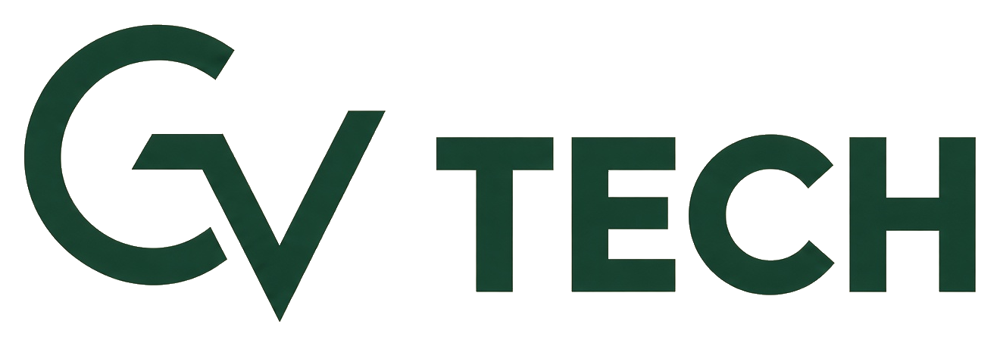

# GV Tech Design System

<p align="center">
  
</p>

[](https://www.npmjs.com/package/@gv-tech/design-system)
[](https://www.npmjs.com/package/@gv-tech/design-system)
[](https://www.npmjs.com/package/@gv-tech/design-system)
[](https://github.com/Garcia-Ventures/gvtech-design/actions/workflows/ci.yml)
[](https://github.com/Garcia-Ventures/gvtech-design/actions/workflows/release.yml)
[](https://nx.dev)
[](LICENSE)
[](https://app.fossa.com/projects/custom%2B20755%2Fgithub.com%2FGarcia-Ventures%2Fgvtech-design?ref=badge_shield&issueType=license)
[](https://www.buymeacoffee.com/eng618)

A React component design system. This repository provides a lightweight, opinionated set of UI components and tooling used by Garcia Ventures projects, built with **Nx**, **Vite**, and **TypeScript**.

> **Docs:** start at [`docs/index.md`](docs/index.md) — Tutorials (setup, first usage, create a component), How-to guides, Reference (registry, parity, divergence), Explanation (architecture, ADRs, roadmap).

---

**Table of Contents**

- [GV Tech Design System](#gv-tech-design-system)
  - [Demo](#demo)
  - [Install](#install)
  - [Usage](#usage)
  - [Development](#development)
  - [Testing](#testing)
  - [Releases \& Publishing](#releases--publishing)
  - [Contributing](#contributing)
  - [Roadmap](#roadmap)
  - [Support](#support)
  - [License](#license)

---

## Implementation Status

To see a full list of all available components and their implementation and testing status across Web and Native platforms, please refer to the [Component Registry](docs/reference/component-registry.md). Platform notes: [Parity Matrix](docs/reference/parity-matrix.md) · [Divergence Registry](docs/reference/divergence-registry.md).

## Demo

The design system includes a Vite-based playground site. Run it locally with `bun run dev` or view the hosted version at [design.gventureshq.com](https://design.gventureshq.com/).

## Install

Pick one path. `@gv-tech/ui-web`, `@gv-tech/ui-native`, `@gv-tech/design-tokens`, and `@gv-tech/ui-core` release together.

| You want…                                  | Install                                           |
| :----------------------------------------- | :------------------------------------------------ |
| Web components from the published build    | `@gv-tech/ui-web` and `@gv-tech/design-tokens`    |
| Native components from the published build | `@gv-tech/ui-native` and `@gv-tech/design-tokens` |
| Every web component from one package       | `@gv-tech/design-system`                          |
| To own the web source                      | The shadcn command below                          |

Web, in the global stylesheet, import tokens before Tailwind:

```css
@import '@gv-tech/design-tokens/theme.css';
@import 'tailwindcss';
```

```tsx
import { Button } from '@gv-tech/ui-web';

export function App() {
  return <Button>Click me</Button>;
}
```

Native needs Metro, Babel, NativeWind v5, and `ThemeProvider` before a Button paints. Follow [Set up React Native](docs/how-to/setup-react-native.md).

To own the web source instead of the npm build:

```bash
npx shadcn@latest add "https://github.com/Garcia-Ventures/gvtech-design/tree/main/packages/ui-web"
```

That command copies web components. It does not set up React Native. The supported native install is `@gv-tech/ui-native` plus the how-to above.

The first-use walkthrough is [Use in Your App](docs/tutorials/02-first-app-usage.md).

## Development

Start a local dev server:

```bash
bun run dev
```

Available scripts (selected):

- `bun run dev` — start Vite dev server (Playground site)
- `bun run build` — build the library and registry
- `bun run build:site` — build the playground site
- `bun run test` — run tests locally
- `bun run test:ci` — run tests in CI
- `bun run lint` — run eslint

For full commands and details see `package.json`.

## Testing

Unit tests use Vitest and React Testing Library.

- Run tests locally: `bun run test`
- CI runs: `bun run test:ci`

## Releases & Publishing

We use **Nx Release** to manage versioning and changelogs. Releases are triggered automatically every Sunday or manually via the **Release** GitHub Action.

Publishing uses OIDC via npm Trusted Publishers for `@gv-tech` packages.

## Contributing

New contributor? Start with [Local Setup](docs/tutorials/01-local-setup.md) and [Create a Component](docs/tutorials/03-create-component.md). Then read the full gates in [CONTRIBUTING.md](.github/CONTRIBUTING.md). Key points:

- Follow **Conventional Commits** to ensure release tooling produces accurate changelogs.
- Run `bun run lint` and `bun run test` before opening PRs.

## Roadmap

Tracked design and engineering work lives in the [enhancement program](docs/explanation/enhancement-program.md). The [roadmap note](docs/explanation/roadmap.md) keeps the original vision and points at that program.

## Support

If you find this project useful, consider supporting its development:

[](https://www.buymeacoffee.com/eng618)

## License

This project is licensed under the MIT License. See [LICENSE](LICENSE) for details.

---

> For README best practices, we follow guidance from <https://www.makeareadme.com/>
